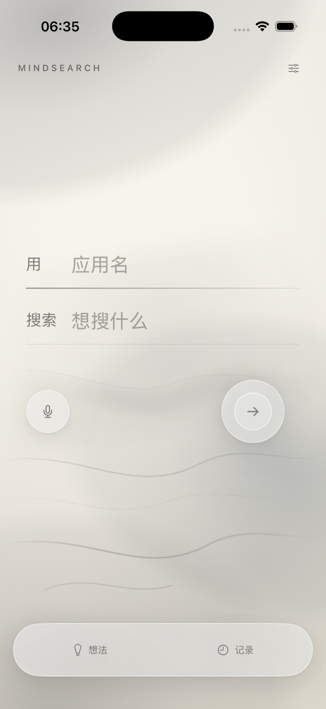
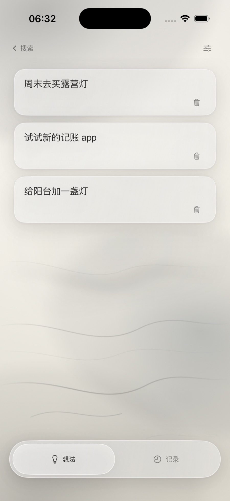
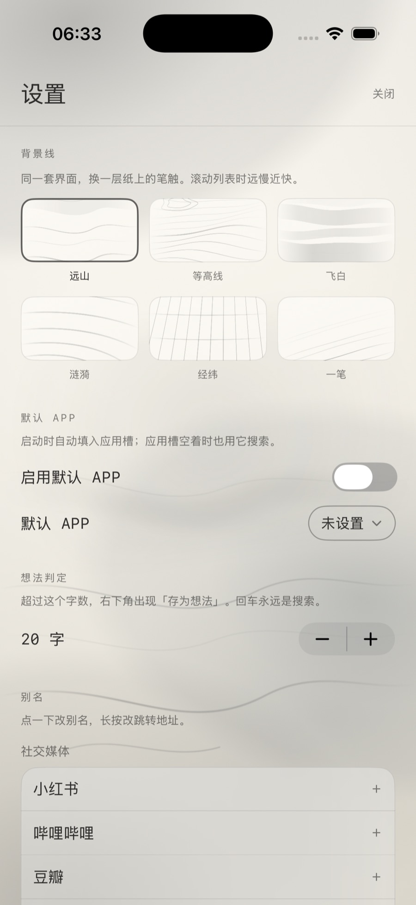

# MindSearch（一键搜索）

SwiftUI 小工具：输入关键词（或直接说），选一个 App，跳到它的搜索结果。想法和搜索记录存在本地。**v1.1 起带主屏和锁屏小组件。**

## 视觉：水墨玻璃（v3.2）



- 六套背景线：远山 / 等高线 / 飞白 / 涟漪 / 经纬 / 一笔。设置 → 背景线里切换，选择会记住。
- 列表滚动时背景线分层移动：远慢近快；静止时不动，不烧电。
- 可点的 HTML 原型（四页 + 主题切换）：`docs/design/mindsearch-app.html`。

| 想法 | 设置 |
| --- | --- |
|  |  |

## 跑起来

1. 打开 `JumpSearch.xcodeproj`（工程名沿用旧名，App 显示名是 MindSearch）。
2. 真机运行前，在**两个** target 的 Signing & Capabilities 里确认是同一个 Team（工程里已配 `JLJH3T9W5A`）：
   - 主 App：`com.humengdie.JumpSearch`
   - 小组件：`com.humengdie.JumpSearch.Widget`
3. 两个 target 都要打开 **App Groups** 能力，并勾上同一个组 `group.com.humengdie.JumpSearch.shared`（entitlements 文件已经写好，Xcode 首次可能需要在 Capabilities 里点一下让它注册到开发者账号）。
4. 选 iPhone 运行。第一次需要在手机上「设置 → 通用 → VPN与设备管理」信任开发者。

模拟器里没有这些 App，跳转只能在真机上验证；模拟器可以看界面和交互，也能预览小组件布局。

## 桌面 / 锁屏小组件（v1.1）

长按桌面 → 编辑 → 添加小组件 → 搜「MindSearch」，会看到两种：

| 名称 | 支持尺寸 | 内容 |
| --- | --- | --- |
| MindSearch 快速搜索 | 小 / 中 / 大 | 最近常用的 4 个应用（不足时补 小红书 / B 站 / 抖音 / 知乎），每个都是独立点击区 |
| MindSearch 锁屏 | 圆形 / 矩形 / 单行 | 最近用的第一个应用 + 最近一次搜索的关键词 |

交互逻辑：

- **点某个应用块** → 唤起 MindSearch 本体，自动填好这个应用名并聚焦关键词框，输入完直接搜。
- **点小组件空白处** → 只打开主 App，聚焦应用槽，走原来那套一句话输入。
- **大号组件的「最近搜过」条** → 带关键词，唤起主 App 后直接执行跳转（不用再打字）。
- 主 App 每次搜索、改设置、改别名 / URL 都会刷新小组件时间线；从没搜过也会显示一排常用应用，不会空白。

**一个绕不开的限制**：Widget Extension 里没有 `UIApplication.shared`，系统不允许它直接打开小红书等第三方 App。所以点击一律先唤起 MindSearch 本体，再由本体完成跳转——这一步多一次转场，但换来的是完全不用手动配置快捷指令。锁屏组件同理，点击后会要求解锁并进入主 App。

数据通路：主 App 写 App Group（`SharedData.swift`）→ Widget 只读 → `mindsearch://search?app=…&q=…` 回传（`WidgetDeepLink.swift` 解析）。

## 已知问题

- 第三方 App 深链是私有约定，可能随对方版本升级失效；设置里长按应用可改 URL。
- 记录列表的左滑删除是自建手势（`DragGesture` + 位移），不是系统 `List` 的原生行为；桌面触控板和 VoiceOver 下请用长按菜单或「删除」无障碍动作。
- DeepSeek 的 `dpsk://` 只能唤起 App，不能带文本（「问问 DeepSeek」是 App Intent，不是 URL scheme），已改成剪贴板模式。
- 剪贴板模式需要你进 App 后手动长按粘贴，iOS 不允许跨 App 自动粘贴。
- 锁屏组件点击后需要解锁，无法在锁屏状态下直接完成跳转。
- 仓库里的截图还是 v1 的三 tab 界面，与当前版本不一致，待重拍。

## 界面

v3.1 起是雾面莫兰迪：一层暖灰渐变打底，灰玫瑰 / 灰蓝 / 雾绿三团雾以 58 秒一个来回慢慢漂，所有平面都是磨砂玻璃。颜色饱和度压在 10% 上下，不抢字。

- **搜索常驻**：底部只留「想法 / 记录」两个入口，搜索永远是根页面；进列表后左上角「‹ 搜索」返回，再点一次当前入口也会回来。
- 首页是一句话：**用（应用）搜索（关键词）**，衬线字体、细线分隔；每次启动自动聚焦应用槽。
- **回车永远是搜索**，任何长度都一样。超过阈值（默认 20 字，设置里可调）时右下角出现雾绿的「存为想法」次按钮，点它才存；长按主按钮也能强制存。
- 关键词框会随内容长高：1 行 42pt，最多 3 行 108pt，再长就在框内滚动。换行键只提交，不会插入换行符。面板里的关键词框同样会长高。
- 主按钮是一个静止的环，不再自己呼吸；有关键词时内圈收紧成雾绿实心圆。
- 应用槽空着、还没打字时，句子下面浮一行「最近 小红书 豆瓣 闲鱼」，点一下填进应用槽并跳到关键词。一旦开始输入就收起。
- 应用槽输入 `XH`，后面灰字预览「小红书」，回车确认；`XY` 预览「闲鱼」，`W` 预览「微博」。中文输入法组词时预览也会跟着显示。
- 应用槽空着且打开了「启用默认 APP」时，才用默认应用；否则回车会提示先选应用。搜索本身不会再偷偷改掉你设置的默认应用。
- **想法是卡片**：点一下就地编辑，回车收起；右下角有删除入口，也支持长按菜单。
- **记录是行**：按「今天 / 昨天 / 更早」分组，0.5pt 细线分隔，左滑超过 72pt 删除，不到就回弹。
- 点记录条目，会从底部升起「换个应用」面板：关键词已填好、可以再改，换完应用回车直接搜索。
- 清空记录会先二次确认。
- 没装对应 App 时弹窗询问，可用网页搜索兜底。
- 右上角图标进设置：默认 APP、想法判定字数、每个 APP 的别名与跳转地址。
- 动效统一用弹簧（按压 0.30 / 状态 0.42 / 页面 0.52 / 面板 0.55）；聚焦输入框时下划线从左边长出一道雾光，存想法时有一个绿点飞向底部「想法」入口。打开「减弱动态效果」后雾会停住、其余动画全部关闭。
- 搜索、存想法、切换页面都有触觉反馈。
- **深色模式**跟随系统：暖黑底、暖白字、亮雾绿，主 App 和小组件同步。
- **首次打开**有三页引导，讲一句话搜索、`XH = 小红书`、长文本存想法；只看一次，文案里的字数阈值跟着设置走。

## 输入识别

- 应用名支持汉字、拼音、首字母和别名，例如 `小红书`、`xiaohongshu`、`xhs`，或者你自定义的别名。
- 不弹候选列表，而是在输入后面直接灰字预览；回车确认预览的应用。
- 组词过程中预览也会实时显示；如果输入法把拼音转成了汉字，不匹配时预览会自动消失。
- 存想法只存关键词，不会带上应用名。
- 输入框用 UIKit 实现，兼容微信、搜狗等第三方输入法的组词过程。

## 语音输入

- 点麦克风开始听，边听边把字写进关键词那一行，再点一下（或停顿一会儿自动结束）。
- 用 iOS 自带的 Speech 框架，中文识别；设备支持离线识别时优先本地处理。
- 第一次会依次弹「语音识别」和「麦克风」权限，都要允许；拒了去 设置 → 隐私 里打开。
- `Info.plist` 已加 `NSMicrophoneUsageDescription` 和 `NSSpeechRecognitionUsageDescription`。

## 内置应用与深链

| 分类 | App | 深链 |
| --- | --- | --- |
| 社交媒体 | 小红书 | `xhsdiscover://search/result?keyword={q}` |
| 社交媒体 | 哔哩哔哩 | `bilibili://search?keyword={q}` |
| 社交媒体 | 豆瓣 | `douban:///search?q={q}` |
| 社交媒体 | 微博 | `sinaweibo://searchall?q={q}` |
| 社交媒体 | 抖音 | `snssdk1128://search?keyword={q}` |
| 社交媒体 | 知乎 | `zhihu://search?q={q}` |
| 社交媒体 | YouTube | `youtube://results?search_query={q}` |
| 购物 | 淘宝 | `taobao://s.taobao.com/search?q={q}` |
| 购物 | 天猫 | `tmall://page.tm/search?q={q}` |
| 购物 | 京东 | `openapp.jdmobile://virtual?params={JSON}` |
| 购物 | 拼多多 | `pinduoduo://yangkeduo.com/search_result.html?search_key={q}` |
| 购物 | 闲鱼 | `fleamarket://x_search_items?keyword={q}` |
| 生活服务 | 美团 | `imeituan://www.meituan.com/search?q={q}` |
| 生活服务 | 大众点评 | `dianping://searchshoplist?keyword={q}` |
| 生活服务 | 饿了么 | `eleme://search?keyword={q}` |
| 音乐 | Spotify | `spotify:search:{q}` |
| AI | DeepSeek | `dpsk://` + **复制关键词到剪贴板** |
| AI | Kimi | `https://www.kimi.com/?q={q}` + 剪贴板兜底 |
| AI | 豆包 | `doubao://chat?text={q}`（App 唤起，可带文本） |
| AI | 文小言 | `https://yiyan.baidu.com/?q={q}` + 剪贴板兜底 |
| AI | 通义 | `https://www.qianwen.com/?q={q}` + 剪贴板兜底 |
| AI | 腾讯元宝 | `https://yuanbao.tencent.com/chat?q={q}` + 剪贴板兜底 |
| AI | ChatGPT | `https://chatgpt.com/?q={q}` + 剪贴板兜底 |

深链怎么找、怎么拼、怎么加白名单，以及新增一个 App 的标准流程，见 [`docs/URL-SCHEMES.md`](docs/URL-SCHEMES.md)。

### 剪贴板模式

DeepSeek 的 `dpsk://` 只能打开 App，URL 带不进文字（「问问 DeepSeek」是 App Intent，不是 URL scheme）。所以这些 AI 改成：**先把关键词复制到剪贴板 → 再打开 App → 你进去长按输入框粘贴**。会震动提示一下，设置里的应用列表带 📋 图标的就是这一类。

其他 AI 大多是网页 `?q=`，参数不一定被接住，也加了同样的剪贴板兜底——无论最后打开的是 App 还是浏览器，剪贴板里都有内容。豆包确认能用 `doubao://chat?text=` 直接带文本，保持直连。

这些都是第三方 App 的私有约定，没有官方文档保证。其中小红书、哔哩哔哩、知乎、微博、豆瓣、YouTube、京东、拼多多、美团、大众点评的写法来自公开整理；抖音、淘宝、天猫、闲鱼、饿了么、Spotify 的搜索路径属于社区流传，需要真机逐条验证，失效时会在应用里提示改用网页搜索。

`Info.plist` 的 `LSApplicationQueriesSchemes` 已包含上表所有自定义 scheme（缺一个，该 App 的 `canOpenURL` 就会一直返回 false）。Kimi / 文小言 / 通义 / 腾讯元宝 / ChatGPT 走的是 `https`，不受白名单限制，所以没有列进去。

## 命令行编译

```bash
xcodebuild -project JumpSearch.xcodeproj -scheme JumpSearch -sdk iphonesimulator -configuration Debug -derivedDataPath build/DerivedData CODE_SIGNING_ALLOWED=NO build
```

用 `-scheme`（不要用 `-target`），这样 Xcode 会自动先编 widget extension 再嵌入主 App。

## Roadmap

- [ ] 真机逐条验证所有第三方深链，失效的改成网页兜底或只唤起 App
- [ ] 小组件支持用户自己选固定哪 4 个应用（现在跟着「最近使用」走）
- [ ] 想法 / 记录同步到 iCloud（现在只在本地）
